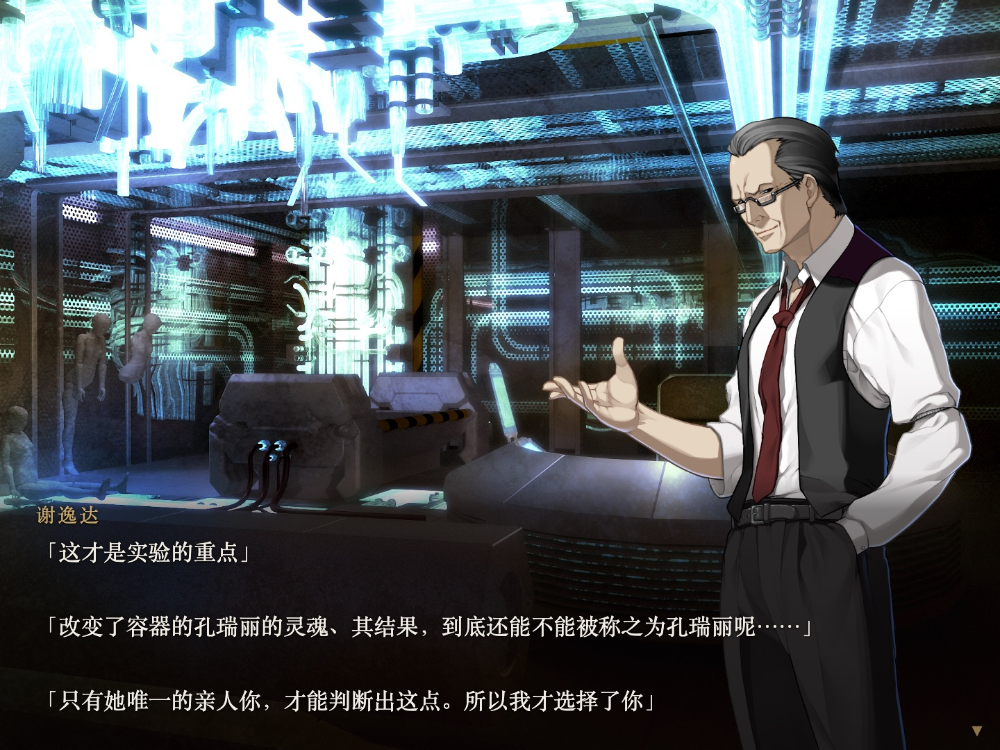
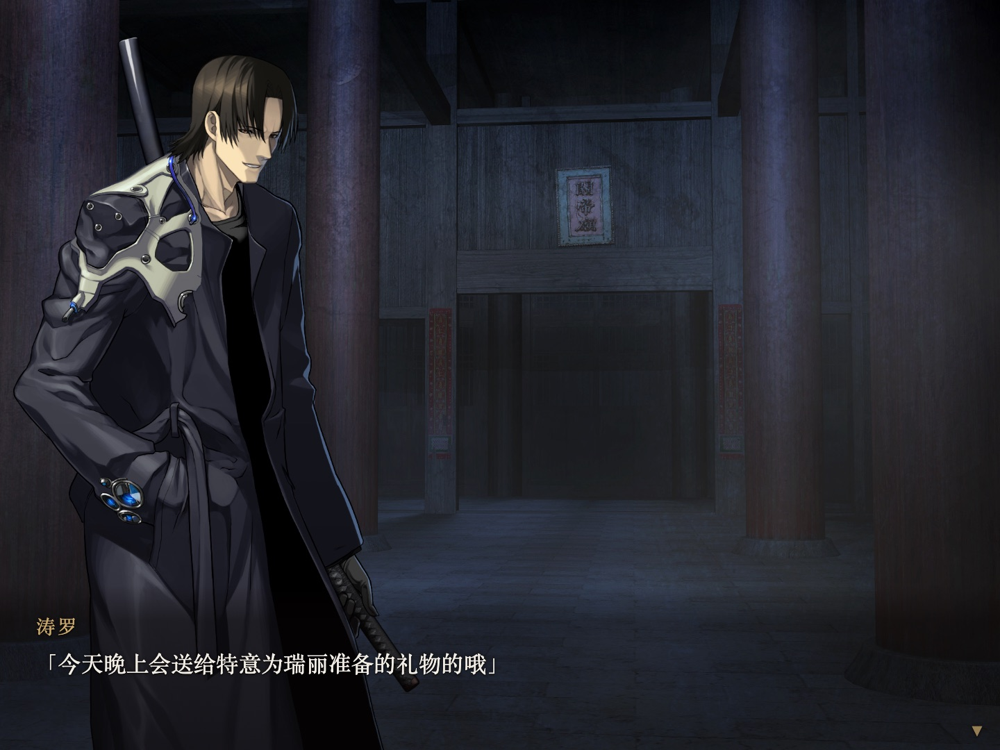
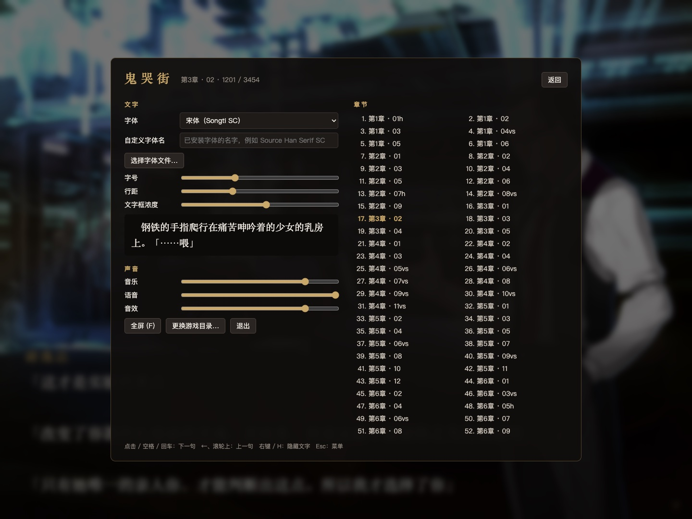

# 鬼哭街 阅读器

在 Mac 上阅读 Nitroplus《鬼哭街》2011 重制版（全语音版）的中文剧情：横排文字、原版 CG 与立绘、角色语音、背景音乐，窗口可放大到约 1440p，字体可换。

本程序直接读取游戏自带的 `.npa` 数据包，不运行游戏的 Windows 程序，也不需要 Wine / CrossOver。



| | |
|---|---|
|  |  |
|  |  |

## 本仓库不包含游戏文件

出于版权原因，这里**只有阅读器的源代码**，不提供任何游戏数据（剧本、图片、语音、音乐、视频），也不提供下载途径。请使用你自己拥有的游戏。

需要准备：

- 《鬼哭街》2011 重制版（Nitroplus，全语音版）
- 萌乃妹汉化组的中文补丁（已安装到游戏目录）

游戏目录里需要有这些文件：

| 文件 | 内容 | 必需 |
|---|---|---|
| `nss.npa` | 剧本 | ✓ |
| `nss-1.npa` | 中文剧本（汉化补丁） | ✓ |
| `cg.npa` | CG、立绘、背景 | ✓ |
| `cg-1.npa` | 汉化后的图片（汉化补丁） | ✓ |
| `voice.npa` | 角色语音 | ✓ |
| `sound.npa` | 背景音乐与音效 | ✓ |
| `dx/*.ngs` | 过场动画 | 可选，需要 ffmpeg |

`system.npa`、`*.exe`、`*.dll` 等其余文件用不到。第一次启动时选择包含上面这些文件的那个文件夹即可。

2002 年的原版（NScripter 引擎、无语音）不受支持。

## 构建

需要 macOS、[Go](https://go.dev/) 1.26+、Xcode 命令行工具和 [Wails](https://wails.io/) v2：

```bash
go install github.com/wailsapp/wails/v2/cmd/wails@latest
./build.sh
```

生成的程序在 `build/bin/kikoku.app`。`build.sh` 会给它加上本机签名（ad-hoc），否则 Apple Silicon 上的 macOS 会提示"已损坏"。

想看过场动画需要 ffmpeg（`brew install ffmpeg`）。动画第一次播放时转码一次，缓存在 `~/Library/Caches/kikoku-reader/movies`。

## 操作

| 按键 | 作用 |
|---|---|
| 点击 / 空格 / 回车 / 滚轮向下 | 下一句 |
| ← / 滚轮向上 | 上一句 |
| 右键 / H | 隐藏文字框 |
| 按住 Ctrl | 快进 |
| F | 全屏 |
| Esc | 菜单：字体、字号、行距、文字框浓度、音量、章节跳转 |

字体可以从系统字体中选，也可以填已安装字体的名字，或直接选一个字体文件。设置和阅读进度保存在 `~/Library/Application Support/kikoku-reader/settings.json`，下次打开会从上次的位置继续。

## 范围

这是一个**阅读器**，不是引擎移植。它按顺序还原文字、画面、语音和音乐，但不做：

- 滤镜、震屏、规则遮罩转场等演出效果（部分画面与原作会有差异）
- 原版菜单、存档、CG 鉴赏
- Windows 版

## 工作原理

- `internal/npa`：NPA 数据包读取与解密。解密表通过对数据包内 Ogg 文件头做已知明文分析得到，格式参考了 [GARbro](https://github.com/morkt/GARbro) 的 `ArcNPA.cs`。
- `internal/assets`：在多个数据包中查找资源（汉化包优先，优先使用 2048×1536 的高清版本）。
- `internal/script`：解析 `.nss` 剧本（台词为 GBK，其余为 Shift-JIS），沿 `0101h.nss → … → 0609.nss` 的剧情链，用一个简化的状态机把图层、声音、台词指令编译成一步一步的阅读页。
- `internal/audio`：Ogg Vorbis 混音（背景音乐、语音、音效）。
- `internal/movie`：用 ffmpeg 把 `.ngs`（MPEG-PS）转成 mp4。
- `app.go`、`frontend/dist`：Wails 窗口与 HTML/CSS 阅读界面。

开发用工具：`cmd/npatool`（列出/解出数据包）、`cmd/dumpbook`（打印编译后的阅读页）、`cmd/npakey`（解密表恢复）、`cmd/playtest`（声音测试）。
`go build -tags desktop,production -o bin/kikoku-preview . && bin/kikoku-preview -preview :8090` 会把阅读界面开在普通浏览器里，方便调试（没有声音；地址后加 `#步数` 可直接跳到某一页）。

## 许可

源代码以 [MIT](LICENSE) 许可发布。《鬼哭街》及其全部素材版权归 Nitroplus 所有；中文翻译归萌乃妹汉化组。截图仅用于展示本程序的效果。本项目与上述权利方无关。
